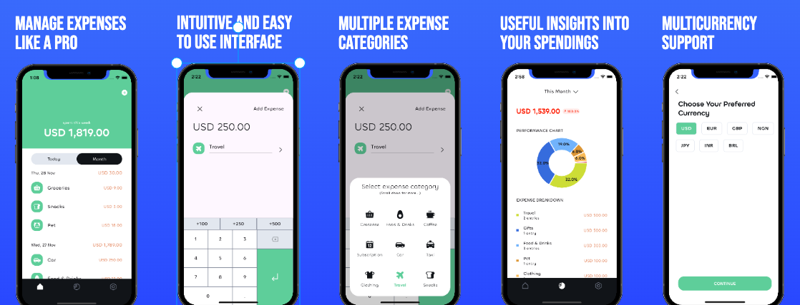

# Expense Bud

A comprehensive finance tracking app to help you manage both income and expenses, staying on top of your financial goals 🚀

<a href="https://play.google.com/store/apps/details?id=app.expensebud">

<a/>

This app was built with clean architecture and MVVM pattern

**motivation**: To have clear seperation of concerns with loosely coupled components and a undirectional flow of data, This means our app is maintainable, scalable and testable.

## Features

- Track both income and expenses in one place
- Categorize transactions with intuitive icons
- View financial balance and summaries
- Analyze spending patterns with insights
- Multiple time period views (daily, weekly, monthly)
- Clean, intuitive user interface

### Screenshots

<p>
    
</p>

### Frameworks/Lib

**flutter:** Google's UI toolkit for building cross platform apps\
**provider:** State management library\
**get_it:** Dependency injection framework\
**hive:** Super fast key-value database library

### Architecture

The app follows clean architecture principles with the following layers:

- **Presentation Layer**: UI components and view models (providers)
- **Domain Layer**: Business logic and use cases
- **Data Layer**: Repositories and data sources

This separation ensures the app is maintainable and testable while allowing for easy feature additions like the recent income tracking functionality.

### Run Locally

Clone the project

```bash
  git clone https://github.com/Iamstanlee/expense_bud.git
```

Go to the project directory

```bash
  cd expense_bud
```

Install dependencies

```bash
  flutter pub get
```

Run the app android or ios simulator

```bash
  flutter run
```

### Running Tests

To run tests, run the following command

```bash
  flutter test
```
